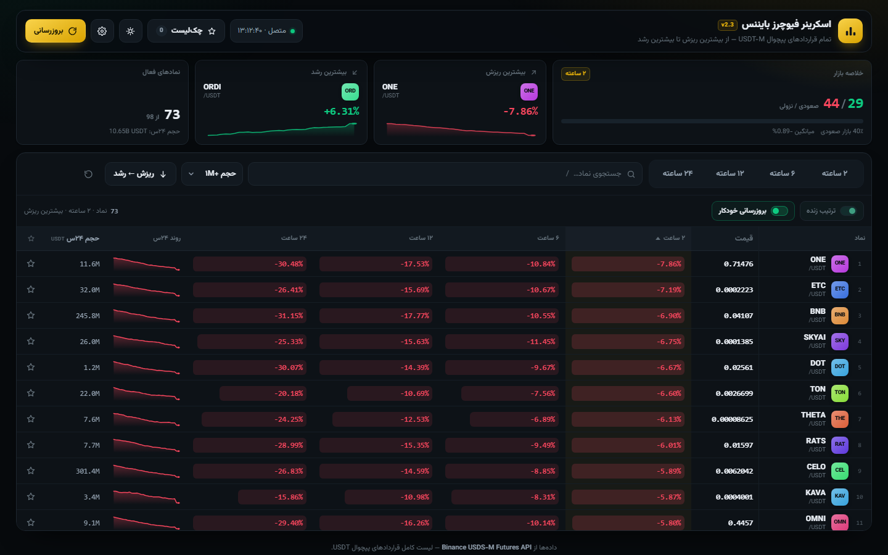
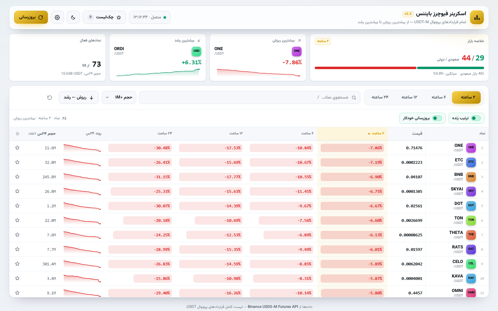
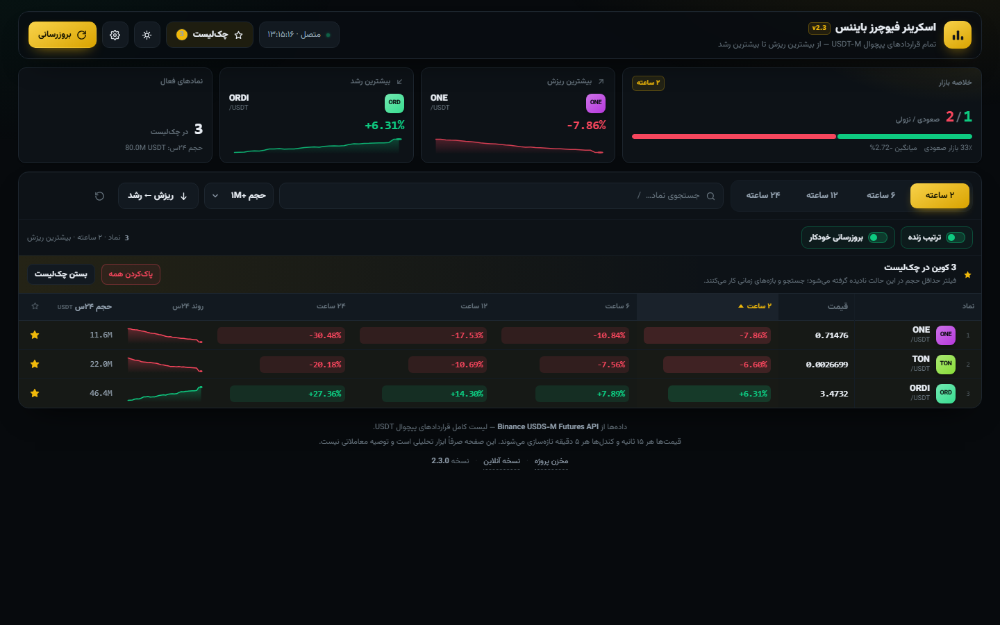
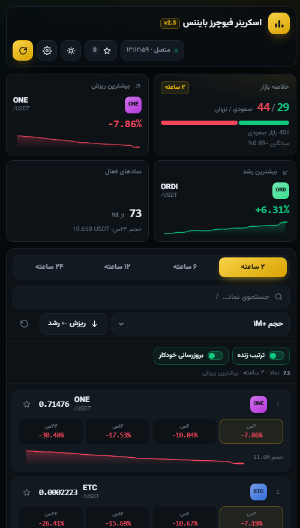

# اسکرینر فیوچرز بایننس

صفحه‌ی وب سبک برای دیدن **همه‌ی کوین‌های فیوچرز USDT-M بایننس**، مرتب‌شده از بیشترین ریزش تا بیشترین رشد، در بازه‌های **۲ / ۶ / ۱۲ / ۲۴ ساعته**.


**نسخه آنلاین (بدون نصب):** https://nigabyte031.github.io/binance-futures-screener/



<p align="center">
  
  
</p>

<p align="center">
  
</p>

---

## نصب با یک دستور

روی سرور (Ubuntu / Debian / CentOS / Rocky / Alma / Fedora / Arch / Alpine / openSUSE) همین یک خط:

```bash
curl -fsSL https://raw.githubusercontent.com/NigaByte031/binance-futures-screener/main/install.sh | bash
```

**هیچ سؤالی نمی‌پرسد** و حتی لازم نیست `sudo` را خودتان بنویسید؛ اسکریپت اگر root نباشد خودش با sudo دوباره اجرا می‌شود. در پایان آدرس سایت را چاپ می‌کند.

پشت صحنه چه می‌کند:

1. python3 و ابزار دانلود را بررسی و در صورت نبودن نصب می‌کند
2. **اولین پورت آزاد** را انتخاب می‌کند (از ۸۰۸۰ به بعد) — اگر پورت بگیرید، همان را می‌گیرد
3. فایل‌ها را در `/opt/binance-futures-screener` می‌نشاند و کاربر بدون دسترسی `bfscreener` می‌سازد
4. سرویس **systemd** (یا **OpenRC** روی Alpine) می‌سازد، در بوت ثبت می‌کند و بالا می‌آورد
5. اگر ufw یا firewalld فعال باشد پورت را باز می‌کند
6. با `/healthz` سالم بودن سرویس را **تأیید** می‌کند و آدرس نهایی را چاپ می‌کند

### با دامنه و HTTPS — باز هم یک دستور

```bash
curl -fsSL https://raw.githubusercontent.com/NigaByte031/binance-futures-screener/main/install.sh \
  | bash -s -- --domain screener.example.com --email you@example.com
```

دامنه بدهید، بقیه‌اش خودکار است: نصب nginx، ریورس‌پروکسی، گواهی رایگان Let's Encrypt و ریدایرکت به `https`. (اگر DNS هنوز به سرور وصل نباشد، نصب نمی‌شکند؛ با HTTP بالا می‌آید و دستور اصلاح را چاپ می‌کند.)

### حالت تعاملی (اگر می‌خواهید خودتان انتخاب کنید)

```bash
curl -fsSL https://raw.githubusercontent.com/NigaByte031/binance-futures-screener/main/install.sh | bash -s -- --interactive
```

پورت، دامنه، nginx، SSL، ایمیل و فایروال را تک‌تک می‌پرسد. اگر ترمینال تعاملی نباشد، خودش به حالت خودکار برمی‌گردد.

### گزینه‌ها

| گزینه | کار |
|---|---|
| `--port <n>` | پورت سرویس (پیش‌فرض: اولین پورت آزاد از ۸۰۸۰) |
| `--domain <d>` | دامنه؛ nginx و SSL را هم خودکار راه می‌اندازد |
| `--email <mail>` | ایمیل برای Let's Encrypt |
| `--dir <path>` | مسیر نصب (پیش‌فرض `/opt/binance-futures-screener`) |
| `--bind <addr>` | آدرس bind (پیش‌فرض `0.0.0.0` یا `127.0.0.1` پشت nginx) |
| `--interactive`, `-i` | حالت پرسش‌وپاسخ |
| `--no-nginx` / `--no-ssl` / `--no-firewall` | غیرفعال کردن هر مرحله |
| `--dry-run` | فقط نشان بده چه می‌کند؛ هیچ تغییری اعمال نمی‌شود |
| `--check` | گزارش وضعیت سیستم و نصب فعلی |
| `--uninstall` | حذف کامل |
| `--help` / `--version` | راهنما و نسخه |

### به‌روزرسانی

همان دستور نصب را دوباره بزنید. تنظیمات فعلی (پورت، دامنه، مسیر) از `/etc/binance-screener.install` خوانده می‌شود، از نسخه‌ی نصب‌شده بکاپ گرفته می‌شود و **اگر سرویس جدید بالا نیاید، نسخه‌ی قبلی خودکار برمی‌گردد**.

```bash
curl -fsSL https://raw.githubusercontent.com/NigaByte031/binance-futures-screener/main/install.sh | bash
```

### وضعیت و عیب‌یابی

```bash
# گزارش یک‌نگاهی: سیستم‌عامل، init، پایتون، فایروال، پورت، وضعیت سرویس
curl -fsSL https://raw.githubusercontent.com/NigaByte031/binance-futures-screener/main/install.sh | bash -s -- --check

# ببینید دقیقاً چه کاری انجام می‌شود، بدون تغییر چیزی
curl -fsSL https://raw.githubusercontent.com/NigaByte031/binance-futures-screener/main/install.sh | bash -s -- --dry-run

# لاگ کامل نصب
tail -n 50 /var/log/binance-screener-install.log
```

### حذف کامل

```bash
curl -fsSL https://raw.githubusercontent.com/NigaByte031/binance-futures-screener/main/install.sh | bash -s -- --uninstall
```

سرویس، فایل‌ها، کاربر سرویس و کانفیگ nginx پاک می‌شوند (گواهی SSL در certbot می‌ماند و دستور حذفش چاپ می‌شود).

### چه چیزی روی سرور ساخته می‌شود

| مسیر | چیست |
|---|---|
| `/opt/binance-futures-screener/` | خود برنامه (`index.html` + `server.py`) |
| `/etc/systemd/system/binance-screener.service` | سرویس (یا `/etc/init.d/binance-screener` روی Alpine) |
| `/etc/binance-screener.install` | تنظیمات نصب برای به‌روزرسانی بعدی |
| `/etc/nginx/conf.d/binance-screener.conf` | فقط وقتی دامنه بدهید |
| `/var/log/binance-screener-install.log` | لاگ نصب |

سرویس با کاربر بدون دسترسی اجرا می‌شود و سخت‌سازی systemd دارد (`NoNewPrivileges`, `ProtectSystem`, `PrivateTmp`, محدودیت syscall و …).

---

## نصب با Docker

```bash
git clone https://github.com/NigaByte031/binance-futures-screener.git
cd binance-futures-screener

# پورت را در docker-compose.yml عوض کنید
docker compose up -d
```

یا بدون compose:

```bash
docker build -t binance-screener .
docker run -d --name binance-screener -p 8080:8080 --restart unless-stopped binance-screener
```

---

## اجرای دستی (بدون نصب)

فقط `python3` لازم است:

```bash
git clone https://github.com/NigaByte031/binance-futures-screener.git
cd binance-futures-screener
python3 server.py --port 8080
```

یا حتی ساده‌تر: فایل `index.html` را مستقیم در مرورگر باز کنید — به هیچ سروری نیاز ندارد.

---

## امکانات صفحه

**رابط بازطراحی‌شده (نسخه ۲.۳)**

- **پنل خلاصه‌ی بازار** بالای صفحه: شمارش صعودی/نزولی با نوار سهم بازار و میانگین تغییر، بیشترین ریزش و بیشترین رشد (با نشان کوین و اسپارک‌لاین) و حجم کل ۲۴ ساعته
- **به‌روزرسانی بدون پرش**: هر ۱۵ ثانیه فقط خانه‌های تغییرکرده به‌روز می‌شوند و با یک فلاش سبز/قرمز کوتاه خبر می‌دهند؛ اسکرول و ترتیب ردیف‌ها حفظ می‌شود
- **جدول مرتب**: عرض ستون‌ها ثابت، اعداد مونواسپیس با ارقام هم‌عرض، نوار حرارتی ملایم برای هر درصد، هدر چسبان و ستون نماد چسبان
- **میان‌بر صفحه‌کلید**: `/` جستجو، `R` بارگذاری مجدد، `W` چک‌لیست، `T` تم، `Esc` بستن
- **دکمه‌ی بازنشانی فیلترها** و خط متای نتایج («۴۴۴ نماد · ۲ ساعته · بیشترین ریزش»)
- **اعلان کوتاه** برای هر افزودن/حذف از چک‌لیست
- **نوار بالای فشرده‌شونده** هنگام اسکرول

**چک‌لیست شخصی (نسخه ۲.۱)**

- هر کوین یک **ستاره** دارد: با یک کلیک به چک‌لیست اضافه یا از آن حذف می‌شود (دسکتاپ: ستون سمت چپ جدول، موبایل: گوشه‌ی کارت)
- شمارنده‌ی چک‌لیست روی دکمه‌ی بالای صفحه؛ با زدن آن فقط کوین‌های نشان‌شده نمایش داده می‌شوند
- در حالت چک‌لیست، کارت‌های خلاصه (تعداد، صعودی/نزولی، بیشترین ریزش و رشد) هم فقط روی همان کوین‌ها حساب می‌شوند
- فهرست در `localStorage` مرورگر ذخیره می‌شود؛ بعد از بستن و باز کردن دوباره سر جایش است
- «پاک‌کردن همه» با تأیید دومرحله‌ای؛ در حالت چک‌لیست فیلتر حداقل حجم نادیده گرفته می‌شود تا کوین‌های کم‌حجم هم که خودتان علامت زده‌اید دیده شوند

**چیدمان و ظاهر (نسخه ۲ و ۳)**

- **دو تم آماده**: تیره و روشن — با دکمه‌ی بالای صفحه عوض می‌شود و در مرورگر ذخیره می‌ماند (بار اول از تنظیم سیستم‌عامل پیروی می‌کند)
- **ریسپانسیو واقعی**: روی دسکتاپ جدول کامل با هدر چسبان و ستون نماد چسبان؛ زیر ۹۰۰ پیکسل هر کوین به یک **کارت** تبدیل می‌شود (بدون اسکرول افقی)
- **حالت رنگ چین**: با یک گزینه در تنظیمات، قرمز = رشد و سبز = ریزش می‌شود
- **نقشه‌ی حرارتی درصدها**: شدت رنگ هر خانه با اندازه‌ی تغییر همان بازه متناسب است، پس ریزش‌های سنگین در یک نگاه دیده می‌شوند
- رنگ اختصاصی هر کوین (از روی نام آن ساخته می‌شود) برای پیدا کردن سریع‌تر در لیست
- اعداد فارسی، راست‌به‌چپ کامل، فونت وزیرمتن، `prefers-reduced-motion` و `safe-area` برای موبایل

**کارکرد**

- **چهار بازه**: ۲ / ۶ / ۱۲ / ۲۴ ساعته — با کلیک روی هدر هر ستون ترتیب برعکس می‌شود
- **مرتب‌سازی پیش‌فرض**: از بیشترین ریزش تا بیشترین رشد
- هر ردیف هم‌زمان هر چهار بازه را نشان می‌دهد و ستون فعال هایلایت می‌شود
- پنل خلاصه: تعداد نماد، صعودی/نزولی با نوار سهم بازار، بیشترین ریزش و بیشترین رشد
- جستجوی نماد (میان‌بر `/`) + فیلتر حداقل حجم ۲۴ ساعته + بازنشانی یک‌کلیکی
- اسپارک‌لاین ۲۴ ساعته برای هر نماد
- کلیک روی هر ردیف → صفحه‌ی فیوچرز همان کوین در بایننس
- به‌روزرسانی خودکار: قیمت هر ۱۵ ثانیه، کندل‌ها هر ۵ دقیقه
- تنظیمات: آدرس API، رنگ‌بندی (سبز=رشد یا قرمز=رشد)، تعداد درخواست همزمان

---

## داده‌ها از کجا می‌آید

همه‌چیز مستقیم از API فیوچرز بایننس و از داخل مرورگر گرفته می‌شود:

| کار | اندپوینت |
|---|---|
| لیست قراردادها | `GET /fapi/v1/exchangeInfo` (فیلتر `PERPETUAL` + `TRADING` + `USDT`) |
| قیمت و حجم ۲۴س | `GET /fapi/v1/ticker/24hr` |
| کندل‌ها | `GET /fapi/v1/klines?interval=15m&limit=97` برای هر نماد |

تغییر ۲/۶/۱۲ ساعته از قیمت مرجع همان لحظه (کندل ۱۵ دقیقه‌ای) حساب می‌شود و تغییر ۲۴ ساعته از خود API خوانده می‌شود.

### نکته‌ی مهم درباره‌ی محدودیت منطقه‌ای

آدرس رسمی `fapi.binance.com` در بعضی کشورها (از جمله ایران) کد **۴۵۱** برمی‌گرداند. به همین دلیل برنامه اول سراغ `www.binance.com/fapi/v1` می‌رود که همان API است و هدر `Access-Control-Allow-Origin: *` هم دارد، و اگر آن هم جواب نداد به‌ترتیب `fapi`، `fapi1`، `fapi2` و `fapi3` را امتحان می‌کند. آدرس سالم در `localStorage` ذخیره می‌شود.

اگر سرورتان پشت پروکسی است، از **تنظیمات** صفحه می‌توانید آدرس API دلخواه وارد کنید.

---

## ساختار پروژه

```text
.
├── index.html              # کل برنامه (HTML + CSS + JS، بدون وابستگی)
├── server.py               # وب‌سرور استاتیک کوچک، فقط با کتابخانه‌ی استاندارد پایتون
├── install.sh              # نصب‌کننده‌ی تعاملی (systemd + nginx + SSL)
├── Dockerfile
├── docker-compose.yml
├── CHANGELOG.md            # تاریخچه‌ی نسخه‌ها
└── docs/
    ├── preview.png         # اسکرین‌شات تم تیره
    ├── preview-light.png   # اسکرین‌شات تم روشن
    └── preview-watch.png   # اسکرین‌شات حالت چک‌لیست
```

---

## مدیریت سرویس (نصب با اسکریپت)

```bash
systemctl status binance-screener     # وضعیت
systemctl restart binance-screener    # ری‌استارت
journalctl -u binance-screener -f     # لاگ زنده
curl -s localhost:8080/healthz        # هلث‌چک
```

---

## نسخه‌ها

آخرین نسخه: **2.2.0** (نصب‌کننده‌ی بدون‌پرسش). فهرست تغییرات در [CHANGELOG.md](CHANGELOG.md).

```bash
git tag -l          # لیست نسخه‌ها
git checkout v2.2.0 # برگشت به یک نسخه
```

---

## هشدار

این ابزار فقط داده‌ی عمومی بازار را نمایش می‌دهد و **توصیه‌ی مالی یا معاملاتی نیست**. هیچ کلید API یا اطلاعات حساب لازم ندارد و هیچ سفارشی ارسال نمی‌کند.

## لایسنس

MIT — فایل [LICENSE](LICENSE) را ببینید.
